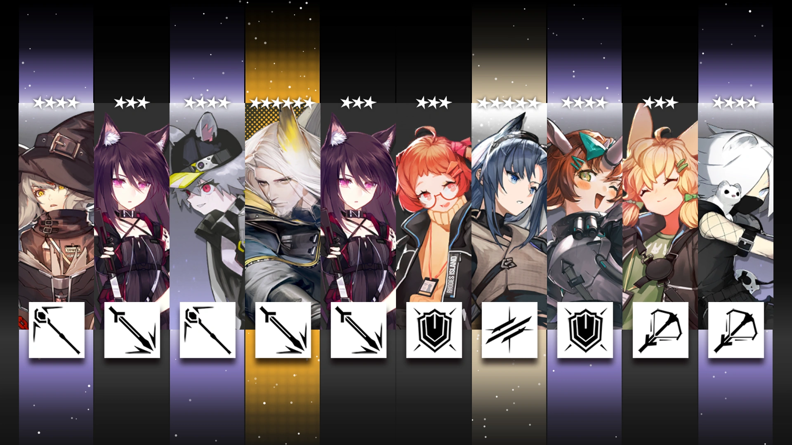

# arknights-gacha-result-generator

Generates an image of an Arknights 10-pull headhunting result: 10 operator portraits with class icons.



```
bun install
bun run cli -- --out out/pull.png   # add --seed N for a reproducible pull and image
bun run web                         # demo page at http://localhost:3000
bun test
```

Library use (from another Bun project, e.g. `bun add file:../arknights-gacha-result-generator`; that installs a *copy*, so re-run
`bun install` there after changing this repo, or use `bun link` for a live link):

```ts
import { generateTenPullImage, seededRng } from "arknights-gacha-result-generator";
const { image, result } = await generateTenPullImage({ rng: seededRng(42) });
await Bun.write("pull.png", image);
```

Options, all optional: `startPity` (whole number, 0 to 98), `guaranteeFiveStar` (default `false`; `true` forces the last pull to 5★ or better if none of the ten was,
as the game does for a banner's first ten pulls), `rng` (one source for the pull and the visuals; `seededRng(n)` with an integer `n`
reproduces an image), `format` (`"png"` or `"webp"`), `cacheDir`, `banner`, `provider` (your own `DataProvider`).
`"png"` is exact and about 1.5 MB; `"webp"` is lossy (quality 95) and about 0.4 MB.
Bad `startPity` or seeds throw a `RangeError`.
Returns `{ image, pulls, result }`: the image bytes, the ten operators in pull order (`name`, `nameEn`, `rarity`, `profession`, `id`; `name` is Chinese,
`nameEn` is English: the English client's name, else the zh_CN `appellation`, else `name`), and the raw pull (`result.operators` ids, `result.finalPity`).

Things to know when calling it from another project:
- A custom `DataProvider` must return `nameEn` on every operator.
- **Set `cacheDir` to an absolute path.** The default `./cache` is relative to wherever your process runs, so a different working directory
  means a new cache and a full re-download. The first pull downloads what it needs from GitHub; after that it is served from disk.
  The operator table and portrait listing refresh after 7 days (the old copy is used if GitHub can't be reached). Images are kept forever.
- The default provider is reused across calls with the same `cacheDir`, so calling in a loop is cheap. A render takes about 1.7 seconds.
- The package exports TypeScript source. Bun runs it as is; if you typecheck with `tsc`, set `allowImportingTsExtensions` (with `noEmit`)
  in your tsconfig.

See [docs/SLICES.md](docs/SLICES.md) for status, decisions and known issues.

## Layout

| Path | Role |
| --- | --- |
| `src/gacha/` | Pure algorithm |
| `src/data/` | `DataProvider` interface, GitHub provider with disk cache, banner pool |
| `src/render/` | sharp montage: layout, tier glows and panels, sparkles, background |
| `src/index.ts` | Public API |
| `src/cli.ts`, `web/` | Frontends over the public API |
| `scripts/` | Manual check against live data |
| `docs/SLICES.md` | Status, decisions, asset findings, known issues |
